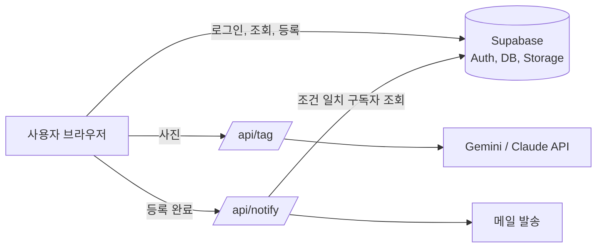

# 교내 분실물 스마트 찾기

학교 이메일로 로그인한 구성원만 이용하는 교내 습득물 공유 서비스입니다.
주운 물건을 사진 한 장으로 등록하면 AI가 카테고리, 색상, 브랜드를 자동으로 입력하고, 잃어버린 사람이 등록해 둔 키워드와 조건이 맞으면 메일로 알려줍니다.

## 배경

현재 교내 분실물은 에브리타임 게시판에 "이런 물건을 주웠다"는 글이 올라오는 방식으로만 공유됩니다. 분실자는 게시판을 직접 검색하거나 넘겨 보며 자기 물건이 올라왔는지 확인해야 합니다.

이 방식에서는 다음과 같은 불편이 생깁니다.

- 분실자가 물건이 올라올 때까지 게시판을 계속 확인해야 한다.
- 글 형식이 자유로워 카테고리, 색상, 장소 같은 조건으로 걸러 찾기 어렵다.
- 물건이 지금 어디에 있는지 위치 정보가 글마다 다르고 부정확하다.
- 물건을 찾아가는 사람이 실제 주인인지 확인하는 절차가 없다.

이 서비스는 분실 알림, 조건 필터, 지도 기반 위치 등록, 선택형 본인 확인 퀴즈로 이 불편을 줄입니다.

## 주요 기능

| 기능 | 설명 |
|---|---|
| 학교 이메일 인증 | 이메일 인증 코드로 로그인합니다. 학교 도메인이 아니면 데이터베이스 단계에서 가입을 거부합니다. |
| AI 자동 태깅 | 사진을 올리면 이미지 AI(Gemini 또는 Claude)가 물건 이름, 카테고리, 색상, 브랜드, 키워드, 설명을 등록 폼에 채웁니다. 무료 한도를 한 사람이 다 쓰지 않도록 1인당 하루 20회로 제한합니다. |
| 지도 기반 위치 등록 | 지도에서 건물을 누르면 건물이 선택되고, 원하는 지점을 누르면 정확한 위치와 가장 가까운 건물이 함께 입력됩니다. 상세 위치는 직접 적습니다. |
| 보관 방법 | 발견한 자리에 그대로 두었는지, 근처 공용 장소에 맡겼는지와 맡긴 곳을 기록합니다. |
| 습득 일시 | 날짜와 시간을 함께 기록하며 미래 시각은 등록할 수 없습니다. |
| 분실 알림 | 키워드에 카테고리, 색상, 건물, 분실 날짜 조건을 더해 등록하면, 조건에 맞는 습득물이 올라올 때 메일과 사이트 알림함으로 알려줍니다. "에어팟"으로 등록하면 "버즈", "이어폰"처럼 같은 종류를 뜻하는 단어가 들어간 물건도 찾으며, 동의어는 `keyword_synonyms` 표에 추가할 수 있습니다. |
| 선택형 본인 확인 퀴즈 | 고가품이나 특징이 뚜렷한 물건에만 권장합니다. 퀴즈가 있는 물건은 건물 이름만 공개되고, 상세 위치와 맡긴 곳은 퀴즈를 통과한 사람에게만 보입니다. 정답은 아무도 조회할 수 없고, 3회 틀리면 온라인 수령 신청이 잠깁니다. 답변이 정답과 표현이 달라도 같은 대상을 가리키면 AI가 정답으로 판단합니다(예: 정답 "고양이", 답변 "톰과 제리의 톰"). 정답보다 넓거나 모호한 답은 틀림으로 처리하고, AI 오류로는 기회가 줄지 않습니다. |
| 상태 관리 | 보관중, 수령 대기, 수령 완료로 바뀝니다. 한 사람이 동시에 수령 대기로 묶어 둘 수 있는 물건은 3건까지입니다. 습득 후 30일이 지나도록 보관중이면 장기 미수령으로 표시됩니다. |
| 게시물 수정 | 작성자는 수령 신청이 들어오기 전까지 내용, 위치, 사진, 퀴즈를 고칠 수 있습니다. 퀴즈를 바꾸면 이전 오답 잠금이 초기화됩니다. |
| 허위 게시물 신고 | 사유를 골라 신고합니다. 서로 다른 3명이 신고하면 게시물이 자동으로 숨겨집니다. 관리자가 문제없다고 판단한 신고가 3건 이상 쌓인 사람의 신고는 관리자 화면에는 올라가지만 자동 숨김 계산에서는 빠집니다. |
| 관리자 화면 | 신고된 게시물을 신고 수 순으로 보고 숨김, 숨김 해제, 신고 기각, 삭제할 수 있습니다. 신고를 받거나, 기각된 신고가 많거나, 퀴즈 오답이 많은 사용자를 확인하고 이용 정지할 수 있으며, 정지된 사용자는 등록, 수령 신청, 신고를 할 수 없습니다. 관리자 추가·삭제를 화면에서 할 수 있고, 숨김·삭제·정지 같은 처리는 누가 언제 했는지 기록으로 남습니다. 숨김을 해제해도 신고 기록은 검토 완료로 보존됩니다. |

권한 규칙은 모두 데이터베이스의 Row Level Security와 함수로 강제됩니다. 브라우저에서 요청을 조작해도 상태를 임의로 바꾸거나 퀴즈 정답과 비공개 위치를 읽을 수 없습니다.

## 기술 스택

- Next.js 16 (App Router)
- Supabase: 인증, PostgreSQL, Storage
- Gemini API: 이미지 자동 태깅
- Leaflet, OpenStreetMap: 캠퍼스 지도
- Nodemailer: 알림 메일 발송
- Vercel: 배포

## 시스템 구조



## 프로젝트 구조

```
app/
  page.js              습득물 피드 (카테고리, 색상, 건물, 상태 필터와 검색)
  login/               학교 이메일 인증 코드 로그인
  items/new/           습득물 등록 (AI 자동 입력, 지도, 퀴즈)
  items/[id]/          상세 (위치, 수령 신청, 수령 완료, 신고)
  items/[id]/edit/     게시물 수정
  admin/               관리자 (신고 처리, 이용 정지)
  alerts/              분실 알림 조건과 알림함
  api/tag/             이미지 자동 태깅
  api/claim/           수령 신청 (퀴즈 답변 AI 판단)
  api/notify/          분실 알림 매칭과 메일 발송
  api/keepalive/       Supabase 무료 프로젝트 일시 정지 방지 (Vercel Cron, 5일마다)
components/            지도, 카드, 인증 상태, 등록·수정 공용 폼
lib/                   상수, 캠퍼스 건물 좌표, Supabase 클라이언트
supabase/schema.sql    테이블, 권한 정책, 상태 변경 함수
tests/                 스키마 권한 테스트, 태깅 응답 처리 테스트, 퀴즈 채점 테스트
```

## 시작하기

### 요구 사항

- Node.js 20 이상
- Supabase 프로젝트

### 설치

1. Supabase SQL Editor에서 `supabase/schema.sql`을 실행합니다. 처음 실행할 때는 SQL Editor에 붙여 넣은 뒤 맨 아래의 학교 이메일 도메인과 첫 관리자 이메일을 바꿔서 실행합니다. 이후 관리자는 사이트의 관리자 화면에서 추가합니다. 이 파일은 다시 실행해도 기존 데이터가 지워지지 않으므로, 스키마가 바뀌면 같은 방법으로 다시 실행합니다.
2. 환경 변수 파일을 만듭니다.

   ```bash
   cp .env.example .env.local
   ```

3. 의존성을 설치하고 개발 서버를 실행합니다.

   ```bash
   npm install
   npm run dev
   ```

### 환경 변수

| 이름 | 필수 | 설명 |
|---|---|---|
| `NEXT_PUBLIC_SUPABASE_URL` | 필수 | Supabase 프로젝트 URL |
| `NEXT_PUBLIC_SUPABASE_ANON_KEY` | 필수 | Supabase publishable(anon) 키 |
| `SUPABASE_SERVICE_ROLE_KEY` | 필수 | Supabase secret(service_role) 키. 서버에서만 사용 |
| `NEXT_PUBLIC_SCHOOL_EMAIL_DOMAIN` | 필수 | 허용할 학교 이메일 도메인 |
| `GEMINI_API_KEY` | 선택 | 이미지 자동 태깅용. 설정하면 Claude보다 우선 사용 |
| `GEMINI_MODEL` | 선택 | 기본값 `gemini-flash-lite-latest` |
| `TAG_DAILY_LIMIT` | 선택 | 1인당 하루 AI 자동 태깅 횟수. 기본값 `20` |
| `ANTHROPIC_API_KEY` | 선택 | 이미지 자동 태깅용. 두 키가 모두 없으면 직접 입력 |
| `ANTHROPIC_MODEL` | 선택 | 기본값 `claude-haiku-5-5` |
| `SMTP_USER`, `SMTP_PASS` | 선택 | 없으면 메일 없이 사이트 알림함만 사용 |
| `SMTP_HOST`, `SMTP_PORT` | 선택 | 기본값 `smtp.gmail.com`, `465` |
| `CRON_SECRET` | 선택 | 주기적으로 실행되는 DB 접속 작업(`/api/keepalive`)을 Vercel 요청만 받도록 제한 |

### 캠퍼스 지도 설정

`lib/campus.js`에서 지도 중심 좌표와 건물 목록(이름, 위도, 경도)을 학교에 맞게 수정합니다.

## 테스트

```bash
npm test
```

`supabase/schema.sql`을 PGlite(WebAssembly PostgreSQL)에서 실행해 다음을 검증합니다.

- 학교 외 이메일 가입 거부, 비로그인 접근 차단
- 퀴즈 정답 비공개, 3회 오답 잠금, 상태 직접 수정 차단
- 퀴즈 AI 판단: 서버만 결과를 기록할 수 있고, 답변으로 채점 지시를 바꿀 수 없음
- 퀴즈 물건의 상세 위치를 작성자, 퀴즈 통과자, 관리자에게만 공개
- 수령 신청, 취소, 완료 흐름과 장기 미수령 표시
- 게시물 수정 권한(작성자, 보관중)과 퀴즈 변경 시 잠금 초기화
- 신고 누적 시 숨김, 본인 게시물 신고 차단, 허위 신고 반복자의 신고 제외
- 관리자 기능의 권한 확인, 신고 처리, 이용 정지와 해제
- 관리자 추가·삭제 규칙, 처리 기록, 검토된 신고 보존과 재신고
- 분실 알림의 조건 매칭, 중복 발송 방지, 타인 이메일 구독 차단
- 분실 알림 동의어 매칭, 색상을 고르지 않은 습득물 매칭
- 사진 업로드 경로 제한

## 한계와 향후 과제

- 알림은 메일과 사이트 알림함으로 제공합니다. 웹 푸시는 지원하지 않습니다.
- 등록자와 수령 신청자 간 메시지 기능이 없습니다.
- 업로드된 사진은 공개 URL로 제공되므로, 개인정보가 보이지 않게 촬영하도록 안내합니다.
